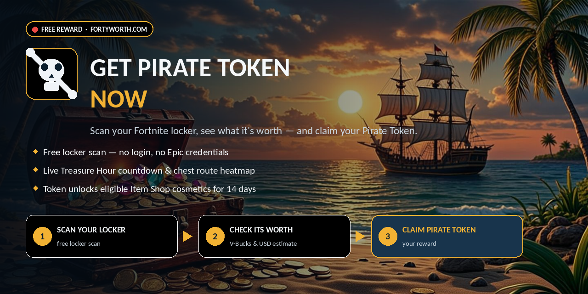
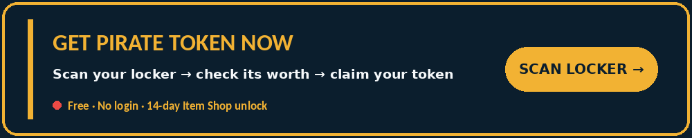
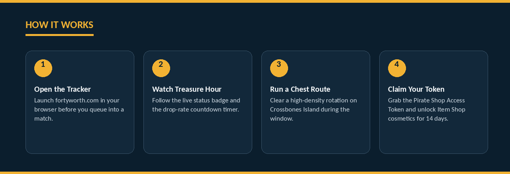
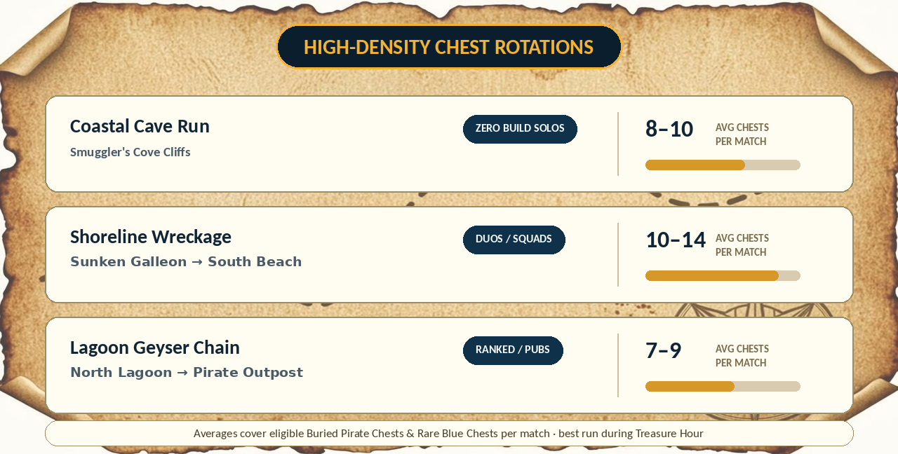

# 🏴‍☠️ How to Get the Pirate Token in Fortnite (2026 Guide)

**Fortnite Pirate Token Finder — the free step-by-step guide + live Treasure Hour tracker, locker
value scan, and Buried Pirate Chest routes for the Treasure Hunters mini-season.**

*Last verified: November 2026* · Tracker: [fortyworth.com](https://fortyworth.com)

 

---

## 🪙 Get Pirate Token Now

**The flow in one line:** scan your locker → check its worth in V-Bucks & USD → claim your
**Pirate Shop Access Token** → unlock eligible Item Shop cosmetics **free for 14 days**. No install,
no login — the site never asks for your Epic Games password.

---

## 🎯 How to Get the Pirate Token in Fortnite (Step by Step)

1. **Open [FortyWorth.com](https://fortyworth.com)** and run the free **locker scan** to see your
   locker's estimated worth — before you queue into a match.
2. **Check the live Treasure Hour status badge** and countdown timer. Drop rates for the Pirate Token
   **spike during Treasure Hour windows** — this is the single biggest speed factor.
3. **Pick a low-traffic chest route** from the Crossbones Island heatmap, or watch active community
   token drops on the live feed.
4. **Clear the route during the window** — every eligible **Buried Pirate Chest** and **Rare Blue
   Chest** you open is a boosted roll while the multiplier is active.
5. **Claim your Pirate Shop Access Token**, then open the Fortnite **Item Shop** and unlock eligible
   outfits, emotes, and bundles **for 14 days**. Anything you claim during the window stays in your
   locker **permanently**.

> 📖 Full walkthrough with troubleshooting:
> **[How to Get the Pirate Token in Fortnite — Step-by-Step Guide](docs/how-to-get-pirate-token-in-fortnite.md)**

---

## 🚀 How to Get the Pirate Token Fast (5 Working Tips)

1. **Queue only inside Treasure Hour.** Outside the window you roll against brutal base RNG — inside
   it, drop rates are significantly boosted.
2. **Start with Shoreline Wreckage.** Sunken Galleon → South Beach packs **10–14 high-tier chests**
   and is best split across lanes in Duos/Squads.
3. **Fall back to Coastal Cave Run.** Contested beaches? Smuggler's Cove sea caves give **8–10
   chests** in Zero Build Solos with far less traffic.
4. **Keep the tracker open on your phone.** The moment the Treasure Hour badge flips, you queue —
   minutes matter.
5. **Claim immediately after the run.** The 14-day Item Shop access clock starts at claim time, and
   claimed cosmetics are yours forever.

> 📖 All speed tactics in detail:
> **[How to Get the Pirate Token in Fortnite Fast — Speed Tips](docs/get-pirate-token-fast.md)**

---

## ⏳ Fortnite Treasure Hour Schedule & Live Timer

Treasure Hour windows are **scheduled server-side** and rotate — stale "fixed time" lists going
around the internet go wrong fast. The tracker shows the **live status badge, countdown to the next
window, and a community feed of verified resets and recent token claims**, which is the only schedule
you can trust.

> 📖 How to read the timer + report a window you observed:
> **[Treasure Hour Schedule & Live Timer](docs/treasure-hour-schedule.md)**

---

## 🧭 Buried Pirate Chest Routes on Crossbones Island

To maximize eligible container rolls per match during active **Treasure Hour** events, run routes
with high concentrations of **Buried Pirate Chests** and **Rare Blue Chests**:

| Route Name | Primary POIs | Best Mode | Avg. High-Tier Chests |
| :--- | :--- | :--- | :--- |
| **Coastal Cave Run** | Smuggler's Cove Cliffs | Zero Build Solos | 8 – 10 Chests |
| **Shoreline Wreckage** | Sunken Galleon → South Beach | Duos / Squads | 10 – 14 Chests |
| **Lagoon Geyser Chain** | North Lagoon → Pirate Outpost | Ranked / Pubs | 7 – 9 Chests |

> 💡 **Tip:** queue the moment the Treasure Hour badge turns live — the multiplier window is short,
> and a full rotation of 8–14 high-tier chests gives you the most eligible rolls while drop rates
> are boosted.

> 📖 Per-route breakdown (sea caves, galleon wrecks, watchtowers):
> **[Buried Pirate Chest Routes — Crossbones Island Guide](docs/chest-routes.md)**

---

## ⚡ Core Tracking Features

| | Feature | What you get |
| :--- | :--- | :--- |
| ⏳ | **Treasure Hour Countdown** | Live timer tracking scheduled server multiplier windows when **Pirate Shop Access Token** drop rates spike. |
| 🗺️ | **Crossbones Island Chest Heatmap** | Interactive route breakdowns covering Smuggler's Cove sea caves, Sunken Galleon wrecks, and North Lagoon watchtowers. |
| 🪙 | **Live Community Drop Feed** | Real-time log of recent token claims, active reward pools, and verified server resets. |
| 💰 | **Free Locker Value Scan** | Estimate your Fortnite locker value / account worth in **V-Bucks and USD** — step one of the token flow. |
| 🎮 | **Cross-Platform Web Access** | Works natively in any desktop or mobile browser (PC, PS5, Xbox Series X\|S, Nintendo Switch) with zero installation required. |

---

## 💰 Bonus: Check Your Fortnite Locker Value & Account Worth

The locker scan that starts the token flow also estimates your inventory's worth in **V-Bucks and
USD** — free, in any browser, with no login. Full walkthrough: **[How to Check Your Fortnite Locker
Value & Account Worth](docs/locker-value.md)**.

---

## 📚 All Guides & Wiki

| Guide | Best for |
| :--- | :--- |
| [How to Get the Pirate Token in Fortnite — Step-by-Step](docs/how-to-get-pirate-token-in-fortnite.md) | The complete walkthrough, requirements, troubleshooting |
| [How to Get the Pirate Token Fast — Speed Tips](docs/get-pirate-token-fast.md) | Getting the token in one or two matches |
| [Treasure Hour Schedule & Live Timer](docs/treasure-hour-schedule.md) | When drop rates are boosted + window reports |
| [Buried Pirate Chest Routes — Crossbones Island](docs/chest-routes.md) | Where to land and which route to run |
| [Locker Value & Account Worth](docs/locker-value.md) | Checking what your locker is worth |

Wiki mirrors: [Home](https://github.com/powerfulrac/fortnite-pirate-token-guide/wiki) ·
[How to Get the Pirate Token](https://github.com/powerfulrac/fortnite-pirate-token-guide/wiki/How-to-Get-the-Pirate-Token) ·
[Treasure Hour](https://github.com/powerfulrac/fortnite-pirate-token-guide/wiki/Treasure-Hour) ·
[Chest Routes](https://github.com/powerfulrac/fortnite-pirate-token-guide/wiki/Chest-Routes)

---

## ❓ FAQ — Fortnite Pirate Token

<b>What does the Pirate Shop Access Token unlock?</b>

 

Complete the free flow on [FortyWorth.com](https://fortyworth.com) — scan your locker, check its
worth, claim your token. The Pirate Token grants **14 days of free access** to eligible outfits,
emotes, and bundles in the Fortnite Item Shop. Any cosmetics claimed during the two-week window
**remain permanently in your locker** — even after the window closes.

<b>How do I get the Pirate Token in Fortnite fast?</b>

 

Queue **only during Treasure Hour** (watch the live badge on
[fortyworth.com](https://fortyworth.com)), run the densest uncontested route — usually **Shoreline
Wreckage** with 10–14 high-tier chests — and claim the token right after the match. Full speed guide:
[How to Get the Pirate Token Fast](docs/get-pirate-token-fast.md).

<b>When are Pirate Token drop odds highest?</b>

 

Drop rates increase significantly during scheduled **Treasure Hour** windows. These windows are
tracked live on the main dashboard with a countdown timer, so you always know when the next boosted
window starts.

<b>Do I need to install anything on my PC or console?</b>

 

No. **[FortyWorth.com](https://fortyworth.com)** runs entirely in your web browser and never asks for
your Epic Games password or sensitive account credentials. Just open the page, scan your locker, and
queue into your match.

<b>Is the Pirate Token free? Does it expire?</b>

 

Yes, the token is a **free reward** of the Treasure Hunters mini-season flow. The Item Shop access it
grants lasts **14 days from claim**, but cosmetics you claim inside that window stay in your locker
permanently.

---

## 🤝 Contributing & Security

Found a broken route, an outdated POI name, or a tracker bug? Open an **Issue** — the
[Treasure Hour report](https://github.com/powerfulrac/fortnite-pirate-token-guide/issues/new?template=pirate-token-report.yml)
and [route data correction](https://github.com/powerfulrac/fortnite-pirate-token-guide/issues/new?template=route-data-correction.yml)
templates collect exactly what we need to keep the heatmap honest. Security concerns are covered in
[SECURITY.md](SECURITY.md).

---

## ⚠️ Disclaimer

This is an **unofficial, fan-made companion project** for tracking publicly visible game events. It is
not created, sponsored, endorsed, or affiliated with **Epic Games, Inc.** "Fortnite" and related marks
are trademarks of Epic Games, Inc. The tracker never requests account credentials — do not share your
Epic Games password with any third-party site.
